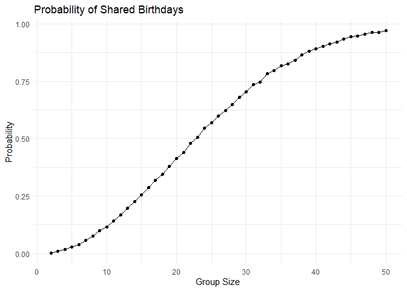
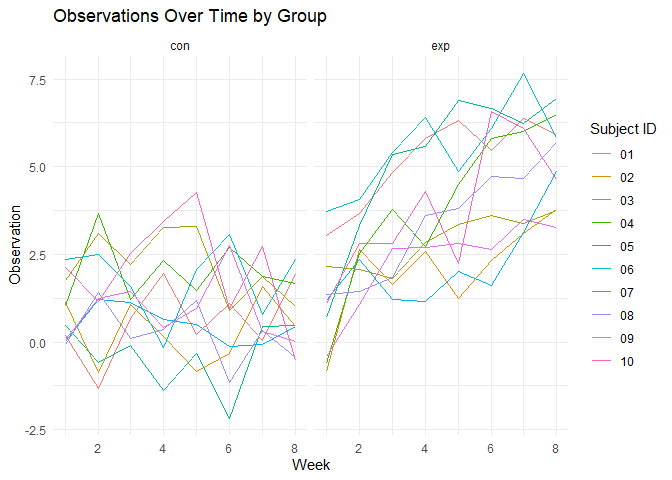
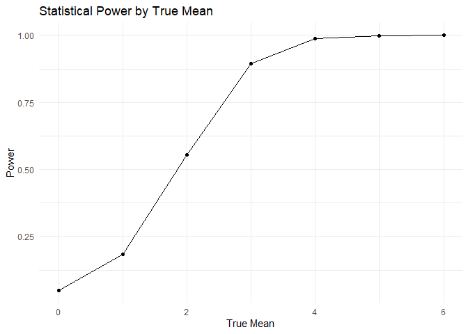
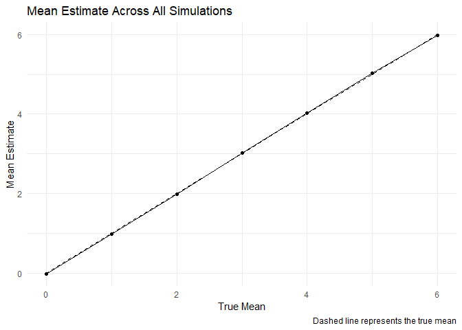
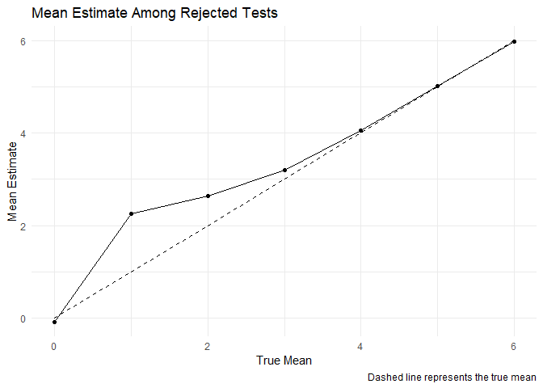

P8105 Homework 5
================
Haoyuan Dou
2026-11-18

# Problem 1

``` r
library(tidyverse)
```

    ## ── Attaching core tidyverse packages ──────────────────────── tidyverse 2.0.0 ──
    ## ✔ dplyr     1.2.1     ✔ readr     2.2.0
    ## ✔ forcats   1.0.1     ✔ stringr   1.6.0
    ## ✔ ggplot2   4.0.3     ✔ tibble    3.3.1
    ## ✔ lubridate 1.9.5     ✔ tidyr     1.3.2
    ## ✔ purrr     1.2.2     
    ## ── Conflicts ────────────────────────────────────────── tidyverse_conflicts() ──
    ## ✖ dplyr::filter() masks stats::filter()
    ## ✖ dplyr::lag()    masks stats::lag()
    ## ℹ Use the conflicted package (<http://conflicted.r-lib.org/>) to force all conflicts to become errors

``` r
set.seed(1)
```

``` r
birthday_shared = function(n) {
  birthdays = sample(1:365, size = n, replace = TRUE)
  n_distinct(birthdays) < n
}

birthday_shared(2)
```

    ## [1] FALSE

``` r
birthday_shared(30)
```

    ## [1] TRUE

``` r
birthday_results = 
  expand_grid(
    group_size = 2:50,
    iter = 1:10000
  ) |>
  mutate(
    shared = map_lgl(group_size, birthday_shared)
  ) |>
  group_by(group_size) |>
  summarize(
    probability = mean(shared)
  )

birthday_results
```

    ## # A tibble: 49 × 2
    ##    group_size probability
    ##         <int>       <dbl>
    ##  1          2      0.0024
    ##  2          3      0.0085
    ##  3          4      0.0168
    ##  4          5      0.0291
    ##  5          6      0.0376
    ##  6          7      0.0561
    ##  7          8      0.075 
    ##  8          9      0.0983
    ##  9         10      0.116 
    ## 10         11      0.140 
    ## # ℹ 39 more rows

``` r
birthday_results |>
  ggplot(aes(x = group_size, y = probability)) +
  geom_line() +
  geom_point() +
  labs(
    title = "Probability of Shared Birthdays",
    x = "Group Size",
    y = "Probability"
  ) +
  theme_minimal()
```

<!-- -->

The probability of at least two people sharing a birthday increases as
the group gets bigger. It is a little over 50% with 23 people and about
97% with 50 people.

# Problem 2

``` r
list.files("data/data/")
```

    ##  [1] "con_01.csv" "con_02.csv" "con_03.csv" "con_04.csv" "con_05.csv"
    ##  [6] "con_06.csv" "con_07.csv" "con_08.csv" "con_09.csv" "con_10.csv"
    ## [11] "exp_01.csv" "exp_02.csv" "exp_03.csv" "exp_04.csv" "exp_05.csv"
    ## [16] "exp_06.csv" "exp_07.csv" "exp_08.csv" "exp_09.csv" "exp_10.csv"

``` r
participant_data = 
  tibble(
    files = list.files("data/data/"),
    path = str_c("data/data/", files)
  ) |>
  mutate(
    data = map(path, read_csv)
  )
```

    ## Rows: 1 Columns: 8
    ## ── Column specification ────────────────────────────────────────────────────────
    ## Delimiter: ","
    ## dbl (8): week_1, week_2, week_3, week_4, week_5, week_6, week_7, week_8
    ## 
    ## ℹ Use `spec()` to retrieve the full column specification for this data.
    ## ℹ Specify the column types or set `show_col_types = FALSE` to quiet this message.
    ## Rows: 1 Columns: 8
    ## ── Column specification ────────────────────────────────────────────────────────
    ## Delimiter: ","
    ## dbl (8): week_1, week_2, week_3, week_4, week_5, week_6, week_7, week_8
    ## 
    ## ℹ Use `spec()` to retrieve the full column specification for this data.
    ## ℹ Specify the column types or set `show_col_types = FALSE` to quiet this message.
    ## Rows: 1 Columns: 8
    ## ── Column specification ────────────────────────────────────────────────────────
    ## Delimiter: ","
    ## dbl (8): week_1, week_2, week_3, week_4, week_5, week_6, week_7, week_8
    ## 
    ## ℹ Use `spec()` to retrieve the full column specification for this data.
    ## ℹ Specify the column types or set `show_col_types = FALSE` to quiet this message.
    ## Rows: 1 Columns: 8
    ## ── Column specification ────────────────────────────────────────────────────────
    ## Delimiter: ","
    ## dbl (8): week_1, week_2, week_3, week_4, week_5, week_6, week_7, week_8
    ## 
    ## ℹ Use `spec()` to retrieve the full column specification for this data.
    ## ℹ Specify the column types or set `show_col_types = FALSE` to quiet this message.
    ## Rows: 1 Columns: 8
    ## ── Column specification ────────────────────────────────────────────────────────
    ## Delimiter: ","
    ## dbl (8): week_1, week_2, week_3, week_4, week_5, week_6, week_7, week_8
    ## 
    ## ℹ Use `spec()` to retrieve the full column specification for this data.
    ## ℹ Specify the column types or set `show_col_types = FALSE` to quiet this message.
    ## Rows: 1 Columns: 8
    ## ── Column specification ────────────────────────────────────────────────────────
    ## Delimiter: ","
    ## dbl (8): week_1, week_2, week_3, week_4, week_5, week_6, week_7, week_8
    ## 
    ## ℹ Use `spec()` to retrieve the full column specification for this data.
    ## ℹ Specify the column types or set `show_col_types = FALSE` to quiet this message.
    ## Rows: 1 Columns: 8
    ## ── Column specification ────────────────────────────────────────────────────────
    ## Delimiter: ","
    ## dbl (8): week_1, week_2, week_3, week_4, week_5, week_6, week_7, week_8
    ## 
    ## ℹ Use `spec()` to retrieve the full column specification for this data.
    ## ℹ Specify the column types or set `show_col_types = FALSE` to quiet this message.
    ## Rows: 1 Columns: 8
    ## ── Column specification ────────────────────────────────────────────────────────
    ## Delimiter: ","
    ## dbl (8): week_1, week_2, week_3, week_4, week_5, week_6, week_7, week_8
    ## 
    ## ℹ Use `spec()` to retrieve the full column specification for this data.
    ## ℹ Specify the column types or set `show_col_types = FALSE` to quiet this message.
    ## Rows: 1 Columns: 8
    ## ── Column specification ────────────────────────────────────────────────────────
    ## Delimiter: ","
    ## dbl (8): week_1, week_2, week_3, week_4, week_5, week_6, week_7, week_8
    ## 
    ## ℹ Use `spec()` to retrieve the full column specification for this data.
    ## ℹ Specify the column types or set `show_col_types = FALSE` to quiet this message.
    ## Rows: 1 Columns: 8
    ## ── Column specification ────────────────────────────────────────────────────────
    ## Delimiter: ","
    ## dbl (8): week_1, week_2, week_3, week_4, week_5, week_6, week_7, week_8
    ## 
    ## ℹ Use `spec()` to retrieve the full column specification for this data.
    ## ℹ Specify the column types or set `show_col_types = FALSE` to quiet this message.
    ## Rows: 1 Columns: 8
    ## ── Column specification ────────────────────────────────────────────────────────
    ## Delimiter: ","
    ## dbl (8): week_1, week_2, week_3, week_4, week_5, week_6, week_7, week_8
    ## 
    ## ℹ Use `spec()` to retrieve the full column specification for this data.
    ## ℹ Specify the column types or set `show_col_types = FALSE` to quiet this message.
    ## Rows: 1 Columns: 8
    ## ── Column specification ────────────────────────────────────────────────────────
    ## Delimiter: ","
    ## dbl (8): week_1, week_2, week_3, week_4, week_5, week_6, week_7, week_8
    ## 
    ## ℹ Use `spec()` to retrieve the full column specification for this data.
    ## ℹ Specify the column types or set `show_col_types = FALSE` to quiet this message.
    ## Rows: 1 Columns: 8
    ## ── Column specification ────────────────────────────────────────────────────────
    ## Delimiter: ","
    ## dbl (8): week_1, week_2, week_3, week_4, week_5, week_6, week_7, week_8
    ## 
    ## ℹ Use `spec()` to retrieve the full column specification for this data.
    ## ℹ Specify the column types or set `show_col_types = FALSE` to quiet this message.
    ## Rows: 1 Columns: 8
    ## ── Column specification ────────────────────────────────────────────────────────
    ## Delimiter: ","
    ## dbl (8): week_1, week_2, week_3, week_4, week_5, week_6, week_7, week_8
    ## 
    ## ℹ Use `spec()` to retrieve the full column specification for this data.
    ## ℹ Specify the column types or set `show_col_types = FALSE` to quiet this message.
    ## Rows: 1 Columns: 8
    ## ── Column specification ────────────────────────────────────────────────────────
    ## Delimiter: ","
    ## dbl (8): week_1, week_2, week_3, week_4, week_5, week_6, week_7, week_8
    ## 
    ## ℹ Use `spec()` to retrieve the full column specification for this data.
    ## ℹ Specify the column types or set `show_col_types = FALSE` to quiet this message.
    ## Rows: 1 Columns: 8
    ## ── Column specification ────────────────────────────────────────────────────────
    ## Delimiter: ","
    ## dbl (8): week_1, week_2, week_3, week_4, week_5, week_6, week_7, week_8
    ## 
    ## ℹ Use `spec()` to retrieve the full column specification for this data.
    ## ℹ Specify the column types or set `show_col_types = FALSE` to quiet this message.
    ## Rows: 1 Columns: 8
    ## ── Column specification ────────────────────────────────────────────────────────
    ## Delimiter: ","
    ## dbl (8): week_1, week_2, week_3, week_4, week_5, week_6, week_7, week_8
    ## 
    ## ℹ Use `spec()` to retrieve the full column specification for this data.
    ## ℹ Specify the column types or set `show_col_types = FALSE` to quiet this message.
    ## Rows: 1 Columns: 8
    ## ── Column specification ────────────────────────────────────────────────────────
    ## Delimiter: ","
    ## dbl (8): week_1, week_2, week_3, week_4, week_5, week_6, week_7, week_8
    ## 
    ## ℹ Use `spec()` to retrieve the full column specification for this data.
    ## ℹ Specify the column types or set `show_col_types = FALSE` to quiet this message.
    ## Rows: 1 Columns: 8
    ## ── Column specification ────────────────────────────────────────────────────────
    ## Delimiter: ","
    ## dbl (8): week_1, week_2, week_3, week_4, week_5, week_6, week_7, week_8
    ## 
    ## ℹ Use `spec()` to retrieve the full column specification for this data.
    ## ℹ Specify the column types or set `show_col_types = FALSE` to quiet this message.
    ## Rows: 1 Columns: 8
    ## ── Column specification ────────────────────────────────────────────────────────
    ## Delimiter: ","
    ## dbl (8): week_1, week_2, week_3, week_4, week_5, week_6, week_7, week_8
    ## 
    ## ℹ Use `spec()` to retrieve the full column specification for this data.
    ## ℹ Specify the column types or set `show_col_types = FALSE` to quiet this message.

``` r
participant_data
```

    ## # A tibble: 20 × 3
    ##    files      path                 data              
    ##    <chr>      <chr>                <list>            
    ##  1 con_01.csv data/data/con_01.csv <spc_tbl_ [1 × 8]>
    ##  2 con_02.csv data/data/con_02.csv <spc_tbl_ [1 × 8]>
    ##  3 con_03.csv data/data/con_03.csv <spc_tbl_ [1 × 8]>
    ##  4 con_04.csv data/data/con_04.csv <spc_tbl_ [1 × 8]>
    ##  5 con_05.csv data/data/con_05.csv <spc_tbl_ [1 × 8]>
    ##  6 con_06.csv data/data/con_06.csv <spc_tbl_ [1 × 8]>
    ##  7 con_07.csv data/data/con_07.csv <spc_tbl_ [1 × 8]>
    ##  8 con_08.csv data/data/con_08.csv <spc_tbl_ [1 × 8]>
    ##  9 con_09.csv data/data/con_09.csv <spc_tbl_ [1 × 8]>
    ## 10 con_10.csv data/data/con_10.csv <spc_tbl_ [1 × 8]>
    ## 11 exp_01.csv data/data/exp_01.csv <spc_tbl_ [1 × 8]>
    ## 12 exp_02.csv data/data/exp_02.csv <spc_tbl_ [1 × 8]>
    ## 13 exp_03.csv data/data/exp_03.csv <spc_tbl_ [1 × 8]>
    ## 14 exp_04.csv data/data/exp_04.csv <spc_tbl_ [1 × 8]>
    ## 15 exp_05.csv data/data/exp_05.csv <spc_tbl_ [1 × 8]>
    ## 16 exp_06.csv data/data/exp_06.csv <spc_tbl_ [1 × 8]>
    ## 17 exp_07.csv data/data/exp_07.csv <spc_tbl_ [1 × 8]>
    ## 18 exp_08.csv data/data/exp_08.csv <spc_tbl_ [1 × 8]>
    ## 19 exp_09.csv data/data/exp_09.csv <spc_tbl_ [1 × 8]>
    ## 20 exp_10.csv data/data/exp_10.csv <spc_tbl_ [1 × 8]>

``` r
tidy_data = 
  participant_data |>
  unnest(cols = data) |>
  mutate(
    arm = str_sub(files, 1, 3),
    subject_id = str_sub(files, 5, 6)
  ) |>
  pivot_longer(
    week_1:week_8,
    names_to = "week",
    values_to = "observation",
    names_prefix = "week_"
  ) |>
  mutate(
    week = as.numeric(week)
  ) |>
  select(subject_id, arm, week, observation)

tidy_data
```

    ## # A tibble: 160 × 4
    ##    subject_id arm    week observation
    ##    <chr>      <chr> <dbl>       <dbl>
    ##  1 01         con       1        0.2 
    ##  2 01         con       2       -1.31
    ##  3 01         con       3        0.66
    ##  4 01         con       4        1.96
    ##  5 01         con       5        0.23
    ##  6 01         con       6        1.09
    ##  7 01         con       7        0.05
    ##  8 01         con       8        1.94
    ##  9 02         con       1        1.13
    ## 10 02         con       2       -0.88
    ## # ℹ 150 more rows

``` r
tidy_data |>
  ggplot(aes(x = week, y = observation,
             group = subject_id, color = subject_id)) +
  geom_line() +
  facet_grid(~arm) +
  labs(
    title = "Observations Over Time by Group",
    x = "Week",
    y = "Observation",
    color = "Subject ID"
  ) +
  theme_minimal()
```

<!-- -->

The control group goes up and down over the eight weeks, but there is no
clear overall trend. Most people in the experimental group show an
increase over time. There are also differences between people within
both groups.

# Problem 3

``` r
sim_t_test = function(mu) {
  sim_data = tibble(
    x = rnorm(30, mean = mu, sd = 5)
  )
  t.test(sim_data$x, mu = 0) |>
    broom::tidy() |>
    select(estimate, p.value)
}

sim_t_test(0)
```

    ## # A tibble: 1 × 2
    ##   estimate p.value
    ##      <dbl>   <dbl>
    ## 1   -0.571   0.537

``` r
sim_t_test(3)
```

    ## # A tibble: 1 × 2
    ##   estimate p.value
    ##      <dbl>   <dbl>
    ## 1     3.20 0.00127

``` r
sim_results = 
  expand_grid(
    mu = 0:6,
    iter = 1:5000
  ) |>
  mutate(
    results = map(mu, sim_t_test)
  ) |>
  unnest(results)

sim_results
```

    ## # A tibble: 35,000 × 4
    ##       mu  iter estimate p.value
    ##    <int> <int>    <dbl>   <dbl>
    ##  1     0     1   -0.527  0.629 
    ##  2     0     2   -0.779  0.452 
    ##  3     0     3    0.264  0.765 
    ##  4     0     4   -0.423  0.581 
    ##  5     0     5    1.20   0.205 
    ##  6     0     6    1.35   0.197 
    ##  7     0     7    1.82   0.0845
    ##  8     0     8    0.492  0.652 
    ##  9     0     9    0.715  0.479 
    ## 10     0    10   -0.991  0.197 
    ## # ℹ 34,990 more rows

``` r
power_results = 
  sim_results |>
  group_by(mu) |>
  summarize(
    power = mean(p.value < 0.05)
  )

power_results
```

    ## # A tibble: 7 × 2
    ##      mu  power
    ##   <int>  <dbl>
    ## 1     0 0.0494
    ## 2     1 0.183 
    ## 3     2 0.554 
    ## 4     3 0.896 
    ## 5     4 0.988 
    ## 6     5 0.999 
    ## 7     6 1

``` r
power_results |>
  ggplot(aes(x = mu, y = power)) +
  geom_line() +
  geom_point() +
  labs(
    title = "Statistical Power by True Mean",
    x = "True Mean",
    y = "Power"
  ) +
  theme_minimal()
```

<!-- -->

Power increases as the true mean gets larger. When mu = 0, about 5% of
the tests reject the null hypothesis, which is close to the 0.05
significance level. Power is almost 1 when mu reaches 4.

``` r
estimate_results = 
  sim_results |>
  group_by(mu) |>
  summarize(
    mean_estimate = mean(estimate)
  )

estimate_results
```

    ## # A tibble: 7 × 2
    ##      mu mean_estimate
    ##   <int>         <dbl>
    ## 1     0       -0.0152
    ## 2     1        0.992 
    ## 3     2        2.00  
    ## 4     3        3.02  
    ## 5     4        4.02  
    ## 6     5        5.02  
    ## 7     6        5.97

``` r
rejected_results = 
  sim_results |>
  filter(p.value < 0.05) |>
  group_by(mu) |>
  summarize(
    mean_estimate = mean(estimate)
  )

rejected_results
```

    ## # A tibble: 7 × 2
    ##      mu mean_estimate
    ##   <int>         <dbl>
    ## 1     0       -0.0878
    ## 2     1        2.26  
    ## 3     2        2.63  
    ## 4     3        3.20  
    ## 5     4        4.05  
    ## 6     5        5.02  
    ## 7     6        5.97

``` r
estimate_results |>
  ggplot(aes(x = mu, y = mean_estimate)) +
  geom_line() +
  geom_point() +
  geom_line(aes(y = mu), linetype = "dashed") +
  labs(
    title = "Mean Estimate Across All Simulations",
    x = "True Mean",
    y = "Mean Estimate",
    caption = "Dashed line represents the true mean"
  ) +
  theme_minimal()
```

<!-- -->

``` r
rejected_results |>
  ggplot(aes(x = mu, y = mean_estimate)) +
  geom_line() +
  geom_point() +
  geom_line(aes(y = mu), linetype = "dashed") +
  labs(
    title = "Mean Estimate Among Rejected Tests",
    x = "True Mean",
    y = "Mean Estimate",
    caption = "Dashed line represents the true mean"
  ) +
  theme_minimal()
```

<!-- -->

When all simulations are included, the average estimates are very close
to the true mu values. But when I only look at tests with p-values below
0.05, the estimates are higher than the true values for small positive
mu values. For example, the average estimate is about 2.26 when mu = 1.
This happens because estimates farther from zero are more likely to give
significant results. As mu gets larger, almost all tests are rejected,
so the difference gets smaller. When mu = 0, significant estimates can
be positive or negative, so their average is still close to 0.
